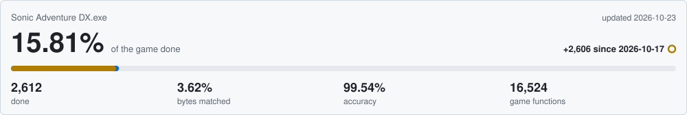
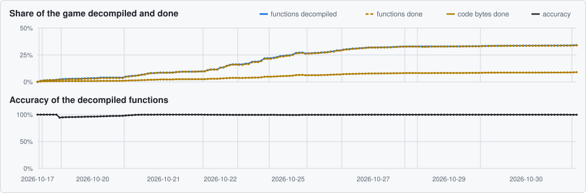
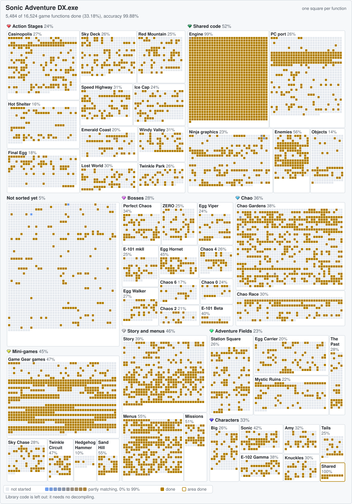

# Sonic Adventure DX Decompilation

A matching decompilation of the 2014 Steam release of Sonic Adventure DX. The
goal is C and C++ source that compiles to the same machine code as the retail
`Sonic Adventure DX.exe`, one function at a time.

> **Status:** early. The game's own compiler and the scoring pipeline are in
> place and verified.

## Progress





### Recent changes

<!-- history:start -->
| Date | Decompiled | Matched | Accuracy | Changes |
| --- | --- | --- | --- | --- |
| 2026-10-18 | 148 / 16,537 (0.89%) | 148 | 100.00% | +FUN_004822c0 100%; +AlrReal_Exe 100%; +AlrReal_exe_for_Race 100%; +AlrReal_Dsp 100%; +AlrReal_Destructor 100%; 351 more |
| 2026-10-17 | 6 / 16,537 (0.04%) | 6 | 100.00% | +std::basic_string<char,std::char_traits<char>,std::allocator<char> >::basic_string<char,std::char_traits<char>,std::allocator<char> > 42.9%; +FUN_00405360 100%; +std::locale::facet::_Incref 89.5%; +std::locale::facet::_Decref 93.1%; +std::locale::~locale 17.0%; 696 more |
<!-- history:end -->

The pre-commit hook runs `check.py save`, which rebuilds
[docs/progress/history.csv](docs/progress/history.csv) and this table from the
commits: one row for each commit that changed a score. CI checks that they match.

### Function map



Open the SVG on its own and hover a scored cell for its address, name and
score. Cells that are not started show nothing.

<details>
<summary>What the colours mean</summary>

| Colour | Meaning |
| --- | --- |
| Dark grey | Not started |
| Grey | Stub: address claimed, body not written yet |
| Red to green | Partial match: closest version's score so far |
| Bright green | 100% match |
| Blue | Runtime library code matching our copy of the library |
| Dark blue | Library code or code the compiler made: linked, not decompiled, not counted |

</details>

## How it works

The decomp runs on a generic framework.
[docs/FRAMEWORK.md](docs/FRAMEWORK.md) explains scoring, the commands and CI.
[docs/PORTING.md](docs/PORTING.md) ports the framework to another game.

**Game functions** are the functions in
[data/functions.csv](data/functions.csv) within a game code range of
[data/codegen-groups.csv](data/codegen-groups.csv), less the four header
functions that [src/header-functions.h](src/header-functions.h) names as
library code. Library code (the C runtime, the CRI middleware and
compiler-made code at the end of `.text`, such as exception funclets) is
linked, not decompiled, and does not count.

<details>
<summary>Is our compiler really the game's compiler?</summary>

The exe's Rich header says it was built with Visual C++ 2010 SP1 (compiler
16.00.40219.01). This project uses that exact compiler. Three checks prove it:

1. **Rich header.** Every tool build that made our exe also appears in the
   game's Rich header (`check.py gate`).
2. **Runtime library.** The game links the C runtime statically. Of the 685
   runtime functions in [src/library.csv](src/library.csv), not counting an
   import stub, 658 score 100% against ours, so both copies are the same
   build. Each of the other 27 has a known cause outside the library, listed
   in [docs/PORTING.md](docs/PORTING.md#traps).
3. **Self-test.** A small known program ([tests/selftest](tests/selftest))
   builds to the same SHA-256 every time, and reccmp scores it exactly as
   pinned: six matches, one near miss at 95.24%, one effective match and one
   stub (`check.py ci`).

The game's code falls into 15 groups using 7 different sets of optimization,
frame pointer, security-check, SSE2 and float settings.
[data/codegen-groups.csv](data/codegen-groups.csv) lists each group's address
range, flags and the evidence for them. The build gives every source file the
flags of its functions' group, so one file may only hold functions from one
group.

The end goal is a byte-for-byte rebuild of the whole exe, which needs every
function decompiled first.

</details>

## Which version do I have?

Only the 2014 Steam release (app 71250, build 411939) is supported. Check
your copy against these:

| | |
| --- | --- |
| File | `Sonic Adventure DX.exe`, 90,922,000 bytes |
| SHA-256 | `e4330c00d7ee3910ecc1acab789ffd2a2d571c506984b99a8de4d3663e697fd6` |
| MD5 | `d526786ad2e3967d084c0b3e1f92cb47` |
| PE timestamp | 2014-10-16 13:56:18 UTC |

Two independent sources confirm it is the retail file:

- **Signature.** The exe has a valid Authenticode signature from SEGA EUROPE
  LIMITED, time-stamped 2014-10-16, shown by Windows under Properties, Digital
  Signatures.
- **Mod Manager** (community).
  [SA Mod Manager](https://github.com/X-Hax/SA-Mod-Manager) lists this MD5 for
  the Steam exe (`SteamSourceData` in `SADXPatchHashes.cs`).

## Building

You need Windows 10 build 17063 or newer, Python 3.10 or newer, git and the
game from Steam. Every command is tested on Windows 11 with Python 3.13 only.
CI is set to run `ci` with Python 3.12 but has not run yet. In your clone:

```console
python tools/check.py setup
python tools/check.py gate
```

`setup` gets everything ready and turns on the git hooks. `git commit` runs
`save` and stages the new scores, and `git push` runs `gate` first. If the game is not in a Steam library, give its path:
`setup --game "<path to Sonic Adventure DX.exe>"`. The path goes in
`reccmp-user.yml`, which stays on your machine. The first run downloads the
compiler from Microsoft (722 MB).
[docs/FRAMEWORK.md](docs/FRAMEWORK.md#what-setup-downloads) says what it
downloads and where it goes.

## Legal

This project is for research and preservation. It contains no game files or
assets and publishes no built exe. You need your own legally obtained copy of
the game: building and scoring read it.

The code in `src/` is new C and C++ code, written to compile to the same machine
code as the retail exe. It recreates SEGA's game, and `data/` describes that
game. SEGA owns Sonic Adventure DX. This project claims no ownership of it and
gives no license for `src/` or `data/`.

The tools, build files, tests and guides are under the MIT license in
[LICENSE](LICENSE). Sonic Adventure DX is a trademark of SEGA. This project is
not affiliated with or endorsed by SEGA.
